# Python File I/O

---

## Table of Contents

1. [What is File I/O?](#1-what-is-file-io)
2. [Why Do We Need Files?](#2-why-do-we-need-files)
3. [Opening Files](#3-opening-files)
4. [File Modes](#4-file-modes)
5. [with open()](#5-with-open)
6. [Reading Files](#6-reading-files)
7. [Writing Files](#7-writing-files)
8. [Appending Files](#8-appending-files)
9. [File Paths](#9-file-paths)
10. [CSV Files](#10-csv-files)
11. [JSON](#11-json)
12. [Exceptions with File I/O](#12-exceptions-with-file-io)
13. [sorted() and key=](#13-sorted-and-key)
14. [Python Scope](#14-python-scope)
15. [Mistakes & Doubts I Had](#15-mistakes--doubts-i-had)
16. [Quick Revision Sheet](#16-quick-revision-sheet)
17. [Practice Questions](#17-practice-questions)
18. [Final File I/O Checklist](#18-final-file-io-checklist)

---

## 1. What is File I/O?

**I/O = Input / Output.**

- **Input** = data coming **into** your program (reading from a file).
- **Output** = data going **out of** your program (writing to a file).

**File I/O** means: *using Python to read data from files and write data to files.*

```
        INPUT (read)                         OUTPUT (write)
   ┌──────────────┐                      ┌──────────────┐
   │  data.txt    │ ───────────────────► │  Python      │
   │  (on disk)   │                      │  program     │
   └──────────────┘                      └──────┬───────┘
                                                │
   ┌──────────────┐ ◄──────────────────────────┘
   │  result.txt  │
   │  (on disk)   │
   └──────────────┘
```

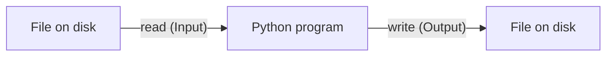

> **Revision box:** File I/O = Python talking to files. Reading = file → Python. Writing = Python → file.

---

## 2. Why Do We Need Files?

### The problem: variables disappear

```python
name = "Harry"
print(name)
```

When the program ends, `name` is **gone**. Python's memory is temporary.

### The solution: files

A file lives on your **disk**, so the data stays even after the program stops.

```
Without files:   Run program → data created → program ends → DATA LOST ❌
With files:      Run program → data saved to file → program ends → DATA STILL THERE ✅
```

### When is File I/O useful?

| Situation | Example |
|-----------|---------|
| Saving results | Save a list of students to a file |
| Loading data | Read a dataset (CSV) for machine learning |
| Configuration | Read settings from a JSON file |
| Logs | Append messages like "program started at 10:00" |
| APIs / AI work | Most AI data comes as CSV or JSON files |

> **Why this matters for AI:** datasets are usually CSV or JSON files. If you can't read files, you can't load data.

---

## 3. Opening Files

### WHAT is `open()`?

`open()` is a built-in Python function that **opens a file** so you can use it. It returns a **file object** (think of it as a "handle" or "remote control" for the file).

### Syntax

```python
file = open("filename", "mode")
```

- `"filename"` → which file
- `"mode"` → what you want to do (`"r"`, `"w"`, `"a"`)

### Simplest example

Imagine a file called `hello.txt` with this inside:

```
Hello Python
```

```python
file = open("hello.txt", "r")   # open for reading
content = file.read()           # read everything
print(content)
file.close()                    # close the file
```

**What Python does:**

```
open("hello.txt", "r")  →  finds the file, opens it, gives me a file object
file.read()             →  reads all text from the file into a string
print(content)          →  shows the string
file.close()            →  closes the file (frees it)
```

**Output:**

```
Hello Python
```

### Flow

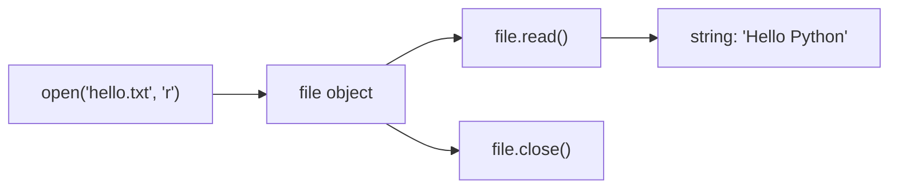

> **Note:** If you don't write a mode, Python uses `"r"` (read) by default.
> Also, for text with special characters you may see `open("file.txt", encoding="utf-8")`. Just remember it exists; you don't need to go deeper right now.

---

## 4. File Modes

The **mode** tells Python what you plan to do with the file.

| Mode | Name | What it does | If file doesn't exist | Existing content |
|------|------|--------------|-----------------------|------------------|
| `"r"` | Read | Only read | ❌ `FileNotFoundError` | Kept (you just read it) |
| `"w"` | Write | Write from scratch | ✅ Creates it | ⚠️ **ERASED** (overwritten) |
| `"a"` | Append | Add to the end | ✅ Creates it | ✅ Kept; new text added at the end |

### Visual: what each mode does to the file

```
File before:      Line 1
                  Line 2

"r"  →  you can read:   Line 1, Line 2           (file unchanged)

"w"  →  file after:     (empty, then new text)   ⚠️ old content gone!

"a"  →  file after:     Line 1
                        Line 2
                        <new text here>          ✅ old content safe
```

### Decision flowchart

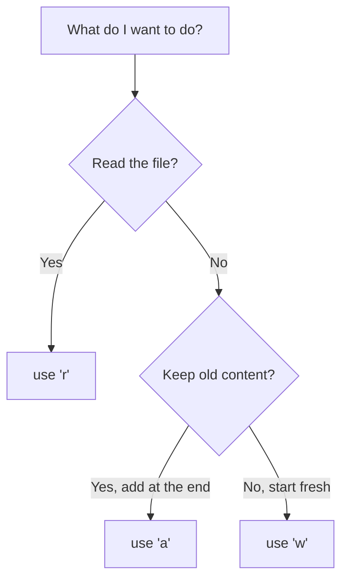

> **Revision box:** `r` = read, `w` = write (erases!), `a` = append (adds to the end).
> There are other modes (like `"rb"` for binary files). You don't need them now.

---

## 5. with open()

### The problem with plain `open()`

When you use `open()`, you must remember to call `file.close()`.

```python
file = open("hello.txt", "r")
content = file.read()
file.close()      # easy to forget!
```

If you forget, the file may stay open, and sometimes your written data may not be saved properly. If an error happens before `close()`, the file never closes.

### The better way: `with open(...)`

```python
with open("hello.txt", "r") as file:
    content = file.read()

# The file is automatically closed here
print(content)
```

**What Python does:**

```
with open("hello.txt", "r") as file:   →  open the file, call it `file`
    content = file.read()              →  use the file inside this indented block
(end of indented block)                →  Python AUTOMATICALLY closes the file
```

### Before → Process → After

```
BEFORE:   file is closed
PROCESS:  with open(...) → file opens → you work inside the block
AFTER:    block ends → file closes automatically (even if an error happened)
```

### Comparison

| | `open()` + `close()` | `with open()` |
|---|---|---|
| Must close manually? | Yes | No, automatic |
| Safe if error happens? | Not always | Yes |
| Recommended? | Rarely | ✅ Almost always |

> **Important:** The variable `content` is still usable after the `with` block ends. Only the *file* is closed. (This is also because `with` does not create a new scope. See [Python Scope](#14-python-scope).)

> **Revision box:** Always prefer `with open(...) as file:`. It closes the file for you.

---

## 6. Reading Files

Say we have `names.txt`:

```
Harry
Hermione
Ron
```

(Each name is on its own line. At the end of each line there is a hidden newline character `\n`.)

So Python actually sees it like this:

```
"Harry\nHermione\nRon\n"
```

### 6.1 `read()`: read everything as ONE string

```python
with open("names.txt") as file:
    content = file.read()

print(content)
print(repr(content))   # repr shows hidden characters like \n
```

**Output:**

```
Harry
Hermione
Ron

'Harry\nHermione\nRon\n'
```

```
names.txt  ──read()──►  "Harry\nHermione\nRon\n"     (ONE big string)
```

### 6.2 `readline()`: read ONE line at a time

```python
with open("names.txt") as file:
    first = file.readline()
    second = file.readline()

print(repr(first))
print(repr(second))
```

**Output:**

```
'Harry\n'
'Hermione\n'
```

Each call to `readline()` moves forward to the **next** line. The line still includes `\n` at the end.

```
Call 1: readline() → "Harry\n"
Call 2: readline() → "Hermione\n"
Call 3: readline() → "Ron\n"
Call 4: readline() → ""        (empty string = end of file)
```

### 6.3 `readlines()`: read ALL lines into a LIST

```python
with open("names.txt") as file:
    lines = file.readlines()

print(lines)
```

**Output:**

```
['Harry\n', 'Hermione\n', 'Ron\n']
```

```
names.txt ──readlines()──► ["Harry\n", "Hermione\n", "Ron\n"]   (a list of strings)
```

### 6.4 `for line in file`: loop line by line

```python
with open("names.txt") as file:
    for line in file:
        print(line)
```

**Output** (notice the blank lines):

```
Harry

Hermione

Ron

```

Why the blank lines? Each `line` is `"Harry\n"`. `print()` adds **another** newline. So two newlines = a blank line.

### Fix with `rstrip()`

`rstrip()` removes whitespace (spaces and `\n`) from the **right end** of a string.

```python
with open("names.txt") as file:
    for line in file:
        print(line.rstrip())
```

**Output:**

```
Harry
Hermione
Ron
```

```
line = "Harry\n"
line.rstrip()  →  "Harry"
```

### Execution diagram of the for loop

```
File:  Harry\n | Hermione\n | Ron\n

Loop 1: line = "Harry\n"     → rstrip → "Harry"     → print
Loop 2: line = "Hermione\n"  → rstrip → "Hermione"  → print
Loop 3: line = "Ron\n"       → rstrip → "Ron"       → print
No more lines → loop ends
```

### Comparison table

| Method | Returns | Type | Reads | Best for |
|--------|---------|------|-------|----------|
| `read()` | Whole file | one `str` | Everything at once | Small files, when you need all text |
| `readline()` | One line | `str` | One line per call | Reading line by line manually |
| `readlines()` | All lines | `list` of `str` | Everything at once | When you need a list of lines |
| `for line in file` | One line each loop | `str` | One line at a time | ✅ Most common, works well for big files |

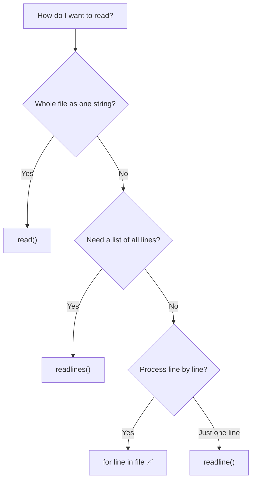

> **Revision box:** Most of the time use `for line in file` with `.rstrip()`.
> Big files? Don't use `read()`/`readlines()`; they load everything into memory.

---

## 7. Writing Files

### WHAT / WHY

Writing means putting text from Python **into** a file. We use mode `"w"`.

### Simplest example

```python
with open("output.txt", "w") as file:
    file.write("Hello")
```

**What Python does:**

```
"w" mode → create output.txt (or erase it if it already exists)
file.write("Hello") → put "Hello" in the file
```

**File content now:**

```
Hello
```

### `write()` does NOT add a new line automatically

```python
with open("output.txt", "w") as file:
    file.write("Harry")
    file.write("Ron")
```

**File content:**

```
HarryRon
```

Add `\n` yourself for a new line:

```python
with open("output.txt", "w") as file:
    file.write("Harry\n")
    file.write("Ron\n")
```

**File content:**

```
Harry
Ron
```

> **Remember:** `print()` adds a newline automatically. `file.write()` does **not**.

### `write()` only accepts strings

```python
file.write(25)         # ❌ TypeError
file.write(str(25))    # ✅ convert to string first
```

### Overwriting warning ⚠️

```python
with open("output.txt", "w") as file:
    file.write("First time\n")

with open("output.txt", "w") as file:   # opens in "w" AGAIN
    file.write("Second time\n")
```

**File content:**

```
Second time
```

```
Run 1:  [ First time ]
Run 2:  "w" erases everything → [ Second time ]     "First time" is LOST
```

### More realistic example: save a list of names

```python
names = ["Harry", "Hermione", "Ron"]

with open("names.txt", "w") as file:
    for name in names:
        file.write(name + "\n")
```

```
names list ──loop──► write "Harry\n" ──► write "Hermione\n" ──► write "Ron\n" ──► names.txt
```

---

## 8. Appending Files

### WHAT / WHY

Appending means **adding to the end** of a file without deleting what is already there. We use mode `"a"`. This is great for logs or collecting data over time.

### Example

```python
with open("log.txt", "a") as file:
    file.write("Program started\n")
```

Run it **twice**. File content:

```
Program started
Program started
```

### Visual: `w` vs `a`

```
File before:    Harry
                Ron

   mode "w" + write("Hermione\n")        mode "a" + write("Hermione\n")
   ─────────────────────────────         ─────────────────────────────
   Hermione                              Harry
                                         Ron
   (Harry and Ron are GONE)              Hermione
                                         (old content kept)
```

### Difference between `w` and `a`

| | `"w"` | `"a"` |
|---|---|---|
| Creates file if missing? | Yes | Yes |
| Old content | **Deleted** | **Kept** |
| Where new text goes | Start (fresh file) | End of file |
| Use for | Saving fresh results | Logs, adding records |

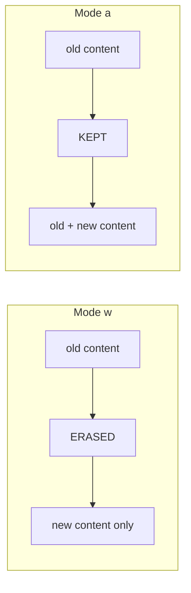

---

## 9. File Paths

### WHAT is a file path?

A **file path** is the **address** of a file on your computer. When you write `open("names.txt")`, Python needs to know *where* `names.txt` is.

### Current Working Directory (CWD)

The **current working directory** is the folder Python is "standing in" right now. When you give just a filename, Python looks for it **in the CWD**.

```python
import os
print(os.getcwd())    # shows the current working directory
```

Example output:

```
C:\Users\Noor\projects\python_notes
```

### Relative path

A path **relative to the current working directory**.

```python
open("names.txt")             # file is in the CWD
open("data/names.txt")        # file is inside the 'data' folder, inside the CWD
open("../names.txt")          # '..' means "go up one folder"
```

### Absolute path

The **full address** from the very top of the drive.

```python
open("C:/Users/Noor/projects/python_notes/names.txt")   # Windows
open("/home/noor/projects/python_notes/names.txt")      # Linux / Mac
```

### Visual: folder tree

```
projects/
└── python_notes/            ← CWD (where Python is "standing")
    ├── main.py
    ├── names.txt            ← open("names.txt")        relative ✅
    └── data/
        └── scores.csv       ← open("data/scores.csv")  relative ✅
```

### Comparison

| | Relative path | Absolute path |
|---|---|---|
| Starts from | Current working directory | Top of the drive (`C:/` or `/`) |
| Example | `"data/names.txt"` | `"C:/Users/Noor/data/names.txt"` |
| Works on other computers? | ✅ Usually yes (if folder structure same) | ❌ Usually no |
| Easier to write? | ✅ | ❌ Long |

### Tips

- Use **forward slashes `/`** even on Windows; Python accepts them.
- On Windows, backslashes need care (`"\n"` means newline!). So write `"C:\\Users\\..."` or use `/`.
- If you get `FileNotFoundError`, first check: *"What is my current working directory? Is the file really there?"*

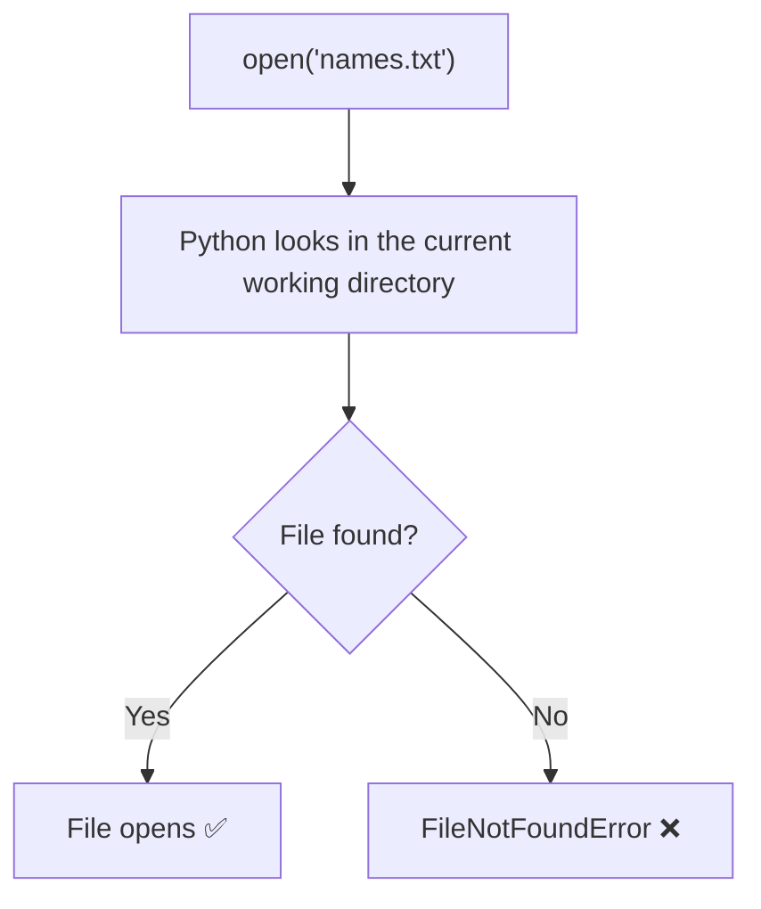

> **Revision box:** Relative = from where I am now. Absolute = full address. `os.getcwd()` tells me where I am.

---

## 10. CSV Files

### 10.1 What is CSV?

**CSV = Comma-Separated Values.** It's a plain-text file where each **line is a row** and values are separated by **commas**.

`students.csv`:

```
name,place
Hermione,Mumbai
Ron,Delhi
Harry,London
```

As a table:

| name | place |
|------|-------|
| Hermione | Mumbai |
| Ron | Delhi |
| Harry | London |

### Why is CSV useful?

- Simple (just text)
- Opens in Excel / Google Sheets
- Most datasets for **data science and AI** are CSV
- Pandas (coming soon!) reads CSV very easily

### 10.2 Reading CSV manually (without the csv module)

`a_Data.csv` (no header row):

```
Hermione,Mumbai
Ron,Delhi
Harry,London
```

```python
students = []

with open("a_Data.csv") as file:
    for line in file:
        name, place = line.rstrip().split(",")

        student = {
            "name": name,
            "place": place
        }

        students.append(student)

print(students)
```

**Step by step (first line):**

```
line                         = "Hermione,Mumbai\n"
line.rstrip()                = "Hermione,Mumbai"
.split(",")                  = ["Hermione", "Mumbai"]
name, place = [...]          → name = "Hermione", place = "Mumbai"
student                      = {"name": "Hermione", "place": "Mumbai"}
students.append(student)     → add the dict to the list
```

**Output:**

```
[{'name': 'Hermione', 'place': 'Mumbai'}, {'name': 'Ron', 'place': 'Delhi'}, {'name': 'Harry', 'place': 'London'}]
```

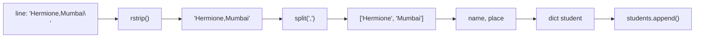

**Problems with manual parsing:**

| Problem | Example |
|---------|---------|
| A value contains a comma | `"Smith, John",London` splits wrongly |
| Blank lines | `"".split(",")` gives `['']` → unpacking error |
| Wrong number of columns | `ValueError: not enough values to unpack` |

The `csv` module handles these things safely. 

### 10.3 The `csv` module

```python
import csv
```

Four main tools:

| Tool | Direction | Works with |
|------|-----------|------------|
| `csv.reader()` | Read | Rows as **lists** |
| `csv.DictReader()` | Read | Rows as **dictionaries** |
| `csv.writer()` | Write | Rows as **lists** |
| `csv.DictWriter()` | Write | Rows as **dictionaries** |

### 10.4 `csv.reader()`

```python
import csv

with open("students.csv") as file:
    reader = csv.reader(file)
    for row in reader:
        print(row)
```

**Output:**

```
['name', 'place']
['Hermione', 'Mumbai']
['Ron', 'Delhi']
['Harry', 'London']
```

- Each `row` is a **list**.
- The **header row is also a row** (the first one).
- You access values by **position**: `row[0]`, `row[1]`.

```python
for row in reader:
    print(row[0], "lives in", row[1])
```

To skip the header: `next(reader)` before the loop.

```
CSV line:  Hermione,Mumbai
               │
         csv.reader
               ▼
row = ["Hermione", "Mumbai"]
        row[0]      row[1]
```

### 10.5 `csv.DictReader()`

```python
import csv

with open("students.csv") as file:
    reader = csv.DictReader(file)
    for row in reader:
        print(row)
```

**Output:**

```
{'name': 'Hermione', 'place': 'Mumbai'}
{'name': 'Ron', 'place': 'Delhi'}
{'name': 'Harry', 'place': 'London'}
```

- `DictReader` uses the **first line as column names (keys)**.
- Each `row` is a **dictionary**. The header is **not** returned as a row.
- You access values by **name**: `row["name"]`, `row["place"]`.

```python
for row in reader:
    print(row["name"], "lives in", row["place"])
```

```
Header line:  name,place     ← becomes the KEYS
Data line:    Hermione,Mumbai
                   │
          csv.DictReader
                   ▼
row = {"name": "Hermione", "place": "Mumbai"}
         row["name"]          row["place"]
```

> ⚠️ All CSV values are **strings**, even numbers. `"25"` is a string. Use `int("25")` to convert.

### 10.6 `reader` vs `DictReader`

| | `csv.reader` | `csv.DictReader` |
|---|---|---|
| Each row is a | list | dictionary |
| Access by | position: `row[0]` | name: `row["name"]` |
| Header row | Returned as a normal row | Used as keys (not returned as data) |
| Readability | Lower (what is `row[1]`?) | ✅ Higher (`row["place"]`) |
| If columns get re-ordered | Code can break ❌ | Code still works ✅ |
| Best for | Simple files, no header | Files with a header row |

### Why is DictReader useful?

```python
print(row[1])          # reader:     what is column 1? I have to remember
print(row["place"])    # DictReader: clear and self-explaining
```

It also matches the structure used by JSON and Pandas later (key → value).

### Collect rows into a list (very common)

```python
import csv

students = []

with open("students.csv") as file:
    reader = csv.DictReader(file)
    for row in reader:
        students.append(row)

print(students)
```

### 10.7 `csv.writer()`

```python
import csv

with open("out.csv", "w", newline="") as file:
    writer = csv.writer(file)
    writer.writerow(["name", "place"])      # header
    writer.writerow(["Harry", "London"])
    writer.writerow(["Ron", "Delhi"])
```

**File content:**

```
name,place
Harry,London
Ron,Delhi
```

- `writerow(list)` writes **one row**.
- `writerows(list_of_lists)` writes **many rows**.
- `newline=""` is recommended when writing CSV (it avoids blank lines between rows on Windows). Just copy this habit.

```python
rows = [["Harry", "London"], ["Ron", "Delhi"]]
writer.writerows(rows)
```

### 10.8 `csv.DictWriter()`

```python
import csv

students = [
    {"name": "Harry", "place": "London"},
    {"name": "Ron", "place": "Delhi"},
]

with open("out.csv", "w", newline="") as file:
    writer = csv.DictWriter(file, fieldnames=["name", "place"])
    writer.writeheader()                 # writes: name,place
    for student in students:
        writer.writerow(student)         # writes each dict as a row
```

**File content:**

```
name,place
Harry,London
Ron,Delhi
```

- `fieldnames=[...]` = the column names and their order.
- `writeheader()` writes the header line.
- `writerow(dict)` writes one dictionary as one row.

### 10.9 Summary map

```
                         CSV FILE
                            │
          ┌─────────────────┴─────────────────┐
        READ                                 WRITE
          │                                    │
   ┌──────┴──────┐                      ┌──────┴───────┐
 reader      DictReader               writer       DictWriter
 (lists)     (dicts)                  (lists)      (dicts)
 row[0]      row["name"]              writerow([..])  writerow({..})
                                                      + writeheader()
```

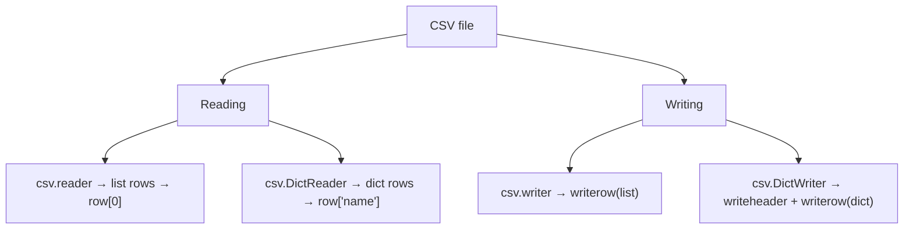

---

## 11. JSON

### 11.1 What is JSON?

**JSON = JavaScript Object Notation.** It is a text format for storing **structured data**. Even though "JavaScript" is in the name, it is used by almost every language, including Python.

Example `student.json`:

```json
{
    "name": "Harry",
    "age": 17,
    "is_student": true,
    "place": "London",
    "subjects": ["Potions", "Charms"],
    "address": null
}
```

### 11.2 Why is JSON used?

- **Standard format** for sending data between programs.
- **Web APIs** send and receive JSON.
- Used for **config / settings files**.
- Human-readable.
- ✅ **AI engineering:** API responses (like AI model APIs), datasets, config files and model settings are very often JSON.

### 11.3 JSON structure

JSON is built from just a few pieces:

| Piece | JSON example | Meaning |
|-------|--------------|---------|
| **Object** | `{ "name": "Harry" }` | A collection of key-value pairs (curly braces) |
| **Array** | `[1, 2, 3]` | An ordered list of values (square brackets) |
| **Key-value pair** | `"name": "Harry"` | A key (always a string in double quotes) and its value |
| String | `"hello"` | Text in **double quotes** |
| Number | `17`, `3.14` | No quotes |
| Boolean | `true`, `false` | Lowercase |
| Null | `null` | "nothing" |

```
{                                  ← OBJECT starts
    "name": "Harry",               ← key-value pair   (key: "name", value: "Harry")
    "age": 17,                     ← key-value pair
    "subjects": ["Potions", ...]   ← value is an ARRAY
}                                  ← OBJECT ends
```

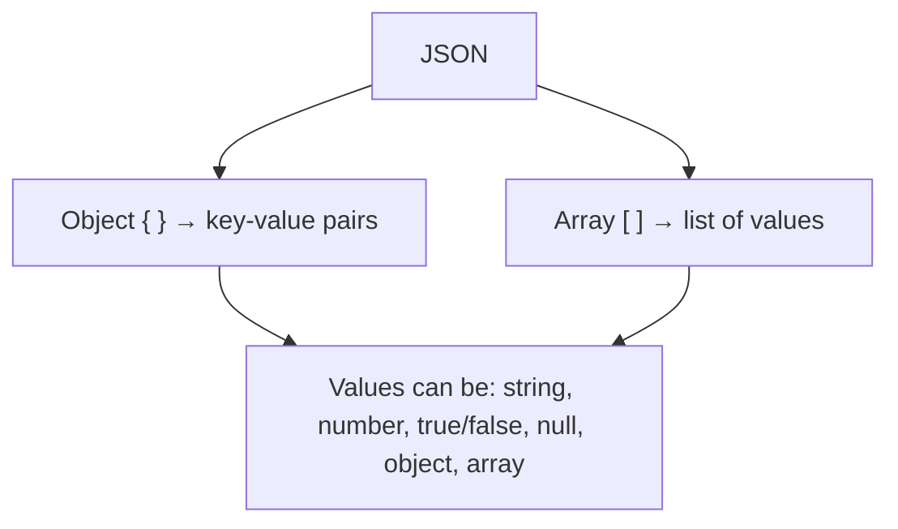

**Nested JSON** (objects/arrays inside objects), very common in APIs:

```json
{
    "students": [
        {"name": "Harry", "place": "London"},
        {"name": "Ron", "place": "Delhi"}
    ]
}
```

### 11.4 Python dictionary/list vs JSON

They look very similar, but they are **not the same thing**. Python has dictionaries and lists as **objects in memory**. JSON is **text** (a string or file) that follows JSON rules.

| Python | JSON |
|--------|------|
| `dict` `{"a": 1}` | object `{"a": 1}` |
| `list` `[1, 2]` | array `[1, 2]` |
| `str` `"hi"` | string `"hi"` |
| `int` / `float` | number |
| `True` / `False` | `true` / `false` |
| `None` | `null` |
| `tuple` | array (becomes a list when loaded back) |
| Strings can use `'single'` or `"double"` quotes | **Only double quotes** `"` |

```
Python world (objects in memory)         JSON world (text)
────────────────────────────────         ──────────────────
{"name": "Harry", "ok": True}   ◄─────►  '{"name": "Harry", "ok": true}'
        dict                                    string / file
```

### 11.5 The `json` module

```python
import json
```

Four main functions. The **`s`** stands for **string**:

| Function | Works with | Direction |
|----------|-----------|-----------|
| `json.load(file)` | **File** | JSON file → Python object |
| `json.dump(obj, file)` | **File** | Python object → JSON file |
| `json.loads(string)` | **String** | JSON string → Python object |
| `json.dumps(obj)` | **String** | Python object → JSON string |

```
                     json.load(file)
   JSON FILE  ───────────────────────────►  Python object
              ◄───────────────────────────  (dict / list)
                  json.dump(obj, file)

                     json.loads(string)
   JSON STRING ──────────────────────────►  Python object
               ◄──────────────────────────  (dict / list)
                  json.dumps(obj)
```

**Memory trick:**

- No `s` → **file** (`load`, `dump`)
- With `s` → **string** (`loads`, `dumps`)
- `load` / `loads` → JSON **into** Python
- `dump` / `dumps` → Python **out to** JSON

### 11.6 Reading a JSON file: `json.load()`

`student.json`:

```json
{"name": "Harry", "age": 17}
```

```python
import json

with open("student.json") as file:
    data = json.load(file)

print(data)
print(type(data))
print(data["name"])
```

**Output:**

```
{'name': 'Harry', 'age': 17}
<class 'dict'>
Harry
```

```
student.json (text) ──json.load(file)──► Python dict ──► data["name"] → "Harry"
```

### 11.7 Writing a JSON file: `json.dump()`

```python
import json

student = {"name": "Harry", "age": 17, "subjects": ["Potions", "Charms"]}

with open("student.json", "w") as file:
    json.dump(student, file, indent=4)
```

**File content:**

```json
{
    "name": "Harry",
    "age": 17,
    "subjects": [
        "Potions",
        "Charms"
    ]
}
```

`indent=4` just makes the file **pretty** (easy to read). It's optional.

### 11.8 JSON string vs JSON file

| | JSON **string** | JSON **file** |
|---|---|---|
| What is it? | Text inside a Python variable | Text saved on disk |
| Read with | `json.loads(string)` | `json.load(file)` |
| Write with | `json.dumps(obj)` | `json.dump(obj, file)` |
| Example | `'{"name": "Harry"}'` | `student.json` |
| Common source | **API response** | Saved data / config |

### 11.9 `json.dumps()`: Python → JSON string

```python
import json

student = {"name": "Harry", "alive": True, "pet": None}

text = json.dumps(student)

print(text)
print(type(text))
```

**Output:**

```
{"name": "Harry", "alive": true, "pet": null}
<class 'str'>
```

Notice: `True → true`, `None → null`, and it is a **string** now, not a dict.

### 11.10 `json.loads()`: JSON string → Python

```python
import json

text = '{"name": "Harry", "alive": true, "pet": null}'

data = json.loads(text)

print(data)
print(type(data))
print(data["alive"])
```

**Output:**

```
{'name': 'Harry', 'alive': True, 'pet': None}
<class 'dict'>
True
```

### 11.11 Basic API-related context

An **API** lets your program talk to another program/server over the internet. Most web APIs reply with **JSON text**.

```
Your Python program ──request──► Server (API)
                    ◄──response── JSON text  '{"city": "London", "temp": 15}'
                                       │
                               json.loads(...)
                                       ▼
                               Python dict → use it!
```

Example idea (you'll learn it properly later; you may need `pip install requests`):

```python
import requests

response = requests.get("https://example.com/api/data")
data = response.json()      # this does the JSON → Python step for you
print(data["city"])
```

Where this matters for AI engineering:

- You **send** a request (often as a dict → JSON via `json`).
- You **receive** JSON back (JSON → dict).
- Then you pick values out with keys like `data["something"]`.

That is why understanding `loads` / `dumps` and dictionaries/lists is very important.

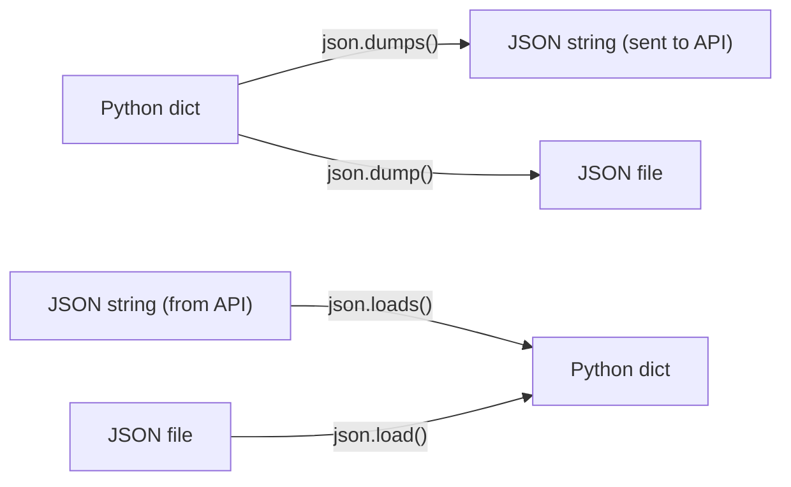

### 11.12 Realistic example: students list as JSON

```python
import json

students = [
    {"name": "Harry", "place": "London"},
    {"name": "Ron", "place": "Delhi"},
]

# SAVE
with open("students.json", "w") as file:
    json.dump(students, file, indent=4)

# LOAD
with open("students.json") as file:
    loaded = json.load(file)

for student in loaded:
    print(student["name"], "lives in", student["place"])
```

**Output:**

```
Harry lives in London
Ron lives in Delhi
```

> ⚠️ Not everything can become JSON (for example, a `set` or your own custom objects). Just remember that JSON supports basic types: dict, list, str, numbers, bool, None.

---

## 12. Exceptions with File I/O

### Why do errors happen with files?

Files live **outside** your program, so many things can go wrong:

| Problem | Python error |
|---------|--------------|
| File doesn't exist / wrong name / wrong path | `FileNotFoundError` |
| You are not allowed to open/write the file | `PermissionError` |
| Path is a folder, not a file | `IsADirectoryError` |
| JSON file has bad format | `json.JSONDecodeError` |

### `FileNotFoundError`

```python
with open("missing.txt") as file:
    print(file.read())
```

**Output:**

```
FileNotFoundError: [Errno 2] No such file or directory: 'missing.txt'
```

Reasons: typo in name, wrong folder, wrong current working directory, or you opened with `"r"` before creating the file.

### Handling it with `try / except`

```python
try:
    with open("missing.txt") as file:
        print(file.read())
except FileNotFoundError:
    print("Sorry, that file does not exist.")
```

**Output:**

```
Sorry, that file does not exist.
```

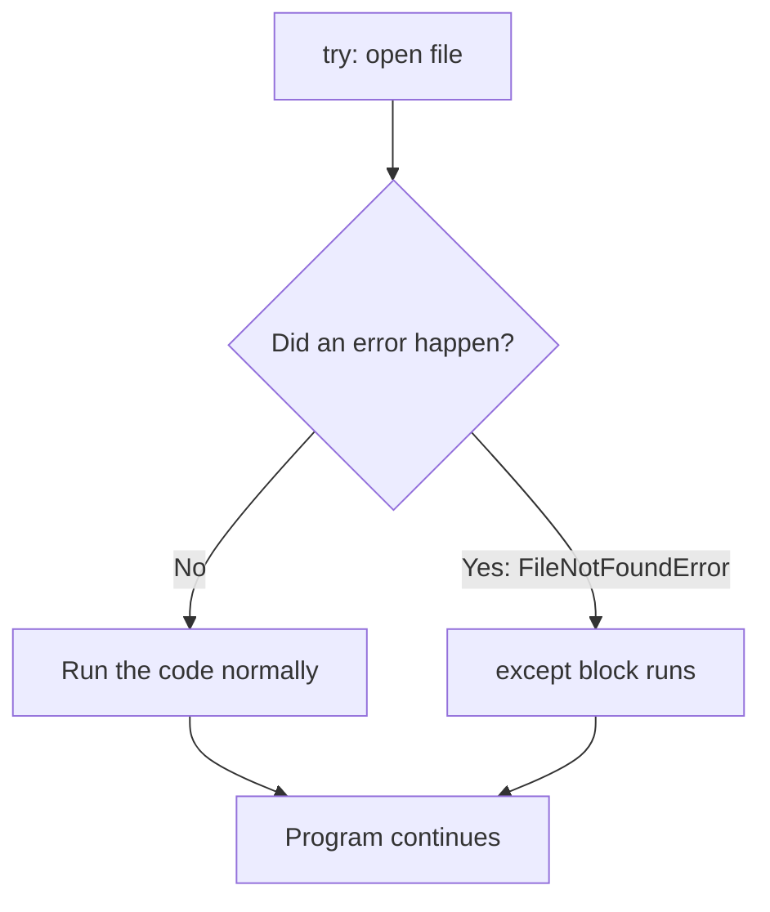

### `PermissionError`

Happens when the operating system says "you can't do that" (for example, writing in a protected folder, or the file is open/locked by another program).

```python
try:
    with open("protected.txt", "w") as file:
        file.write("Hello")
except PermissionError:
    print("You don't have permission to write to this file.")
```

### Handling multiple errors

```python
try:
    with open("data.txt") as file:
        print(file.read())
except FileNotFoundError:
    print("File not found.")
except PermissionError:
    print("No permission.")
```

### JSON-specific: bad JSON

```python
import json

try:
    with open("student.json") as file:
        data = json.load(file)
except FileNotFoundError:
    print("File not found.")
except json.JSONDecodeError:
    print("The file is not valid JSON.")
```

### Realistic example: safe CSV reading

```python
import csv

try:
    with open("students.csv") as file:
        reader = csv.DictReader(file)
        for row in reader:
            print(row["name"], "-", row["place"])
except FileNotFoundError:
    print("students.csv was not found. Check the file name and folder.")
```

> **Tip:** Catch the **specific** error (like `FileNotFoundError`), not a blank `except:`. A blank `except:` hides real bugs.
> **Tip:** When you get `FileNotFoundError`, print `os.getcwd()` to see where Python is looking.

---

## 13. sorted() and key=

> This chapter explains the idea. The detailed "my exact confusion" walkthrough is in [Chapter 15](#15-mistakes--doubts-i-had).

### 13.1 `sorted()`: basics

`sorted()` takes a collection and returns a **new sorted list**. The original is **not** changed.

```python
numbers = [3, 1, 2]
result = sorted(numbers)

print(result)     # [1, 2, 3]
print(numbers)    # [3, 1, 2]   ← original unchanged
```

Strings sort **alphabetically** (A→Z):

```python
print(sorted(["Ron", "Harry", "Hermione"]))
# ['Harry', 'Hermione', 'Ron']
```

```
[3, 1, 2]  ──sorted()──►  [1, 2, 3]   (new list)
```

> Uppercase letters come before lowercase in Python's string sorting: `"Zoe"` comes before `"alice"`.
> There is also `list.sort()`, which sorts a list **in place** and returns `None`. For now, remember `sorted()`.

### 13.2 `reverse=True`

```python
print(sorted([3, 1, 2], reverse=True))
# [3, 2, 1]

print(sorted(["Ron", "Harry", "Hermione"], reverse=True))
# ['Ron', 'Hermione', 'Harry']
```

```
Normal:   A → Z, small → big
Reverse:  Z → A, big → small
```

### 13.3 `key=`: choose WHAT to sort by

Sometimes the items are more complex, like **dictionaries**. Python can't automatically know which part to compare.

```python
students = [
    {"name": "Ron", "place": "Delhi"},
    {"name": "Harry", "place": "London"},
]

sorted(students)     # ❌ TypeError: '<' not supported between 'dict' and 'dict'
```

With `key=`, you tell Python: *"use THIS value for comparing."*

```python
def get_name(student):
    return student["name"]

result = sorted(students, key=get_name)
```

### 13.4 A function as an argument

In Python, functions are **values** that you can hand to other functions, just like numbers or strings.

```python
sorted(students, key=get_name)
#                      ↑
#       passing the FUNCTION itself (no parentheses)
```

`get_name` (no parentheses) = the function **itself**.
`get_name(x)` (with parentheses) = **calling** the function.

### 13.5 `key=len` example

```python
words = ["cat", "elephant", "dog", "ant"]
print(sorted(words, key=len))
```

**Output:**

```
['cat', 'dog', 'ant', 'elephant']
```

`len("cat") = 3`, `len("elephant") = 8`, `len("dog") = 3`, `len("ant") = 3`. So `elephant` goes last. When values are **tied**, Python keeps the **original order** (that's why `cat, dog, ant` stay in that order).

### 13.6 `lambda`: a tiny one-line function

A **lambda** is a short, nameless function.

```python
# Normal function
def get_name(student):
    return student["name"]

# Same thing as a lambda
lambda student: student["name"]
```

Structure:

```
lambda  student  :  student["name"]
  │        │            │
 keyword  parameter    value it RETURNS (no 'return' word needed)
```

Using it directly inside `sorted()`:

```python
result = sorted(students, key=lambda student: student["name"])
```

| | `def` function | `lambda` |
|---|---|---|
| Has a name? | Yes | No |
| Lines | Usually several | One expression |
| Needs `return`? | Yes | No (auto-returns) |
| Use when | Logic is longer / reused | Quick one-time use like `key=` |

### 13.7 Sorting CSV data (realistic example)

```python
import csv

with open("students.csv") as file:
    reader = csv.DictReader(file)
    students = list(reader)

for student in sorted(students, key=lambda student: student["name"]):
    print(student["name"], "lives in", student["place"])
```

**Output** (using the earlier students.csv):

```
Harry lives in London
Hermione lives in Mumbai
Ron lives in Delhi
```

Sort by place, reversed:

```python
for student in sorted(students, key=lambda s: s["place"], reverse=True):
    print(student["place"], "-", student["name"])
```

### 13.8 Summary

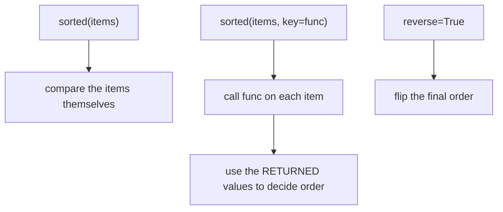

---

## 14. Python Scope

### 14.1 What is scope?

**Scope** = *"Where in my code can a variable be seen and used?"*

Think of rooms in a house: a variable created in one room can only be used in that room (and rooms inside it), unless it was created in the main hall.

### 14.2 Global scope

Variables created **outside** any function are **global**. They can be used almost anywhere in the file.

```python
x = 10          # global

def show():
    print(x)    # can READ the global x

show()          # 10
```

### 14.3 Local (function) scope

A variable created **inside a function** is **local** to that function. It does not exist outside.

```python
def make():
    y = 5
    print(y)

make()          # 5
print(y)        # ❌ NameError: y is not defined
```

```
┌──────────────────────────── GLOBAL SCOPE ─────────────────────────────┐
│  x = 10                                                                │
│                                                                        │
│   ┌──────────── make() LOCAL SCOPE ────────────┐                       │
│   │  y = 5       ← only exists in here         │                       │
│   └────────────────────────────────────────────┘                       │
└────────────────────────────────────────────────────────────────────────┘
```

A function **parameter** is also a local variable:

```python
def greet(name):       # 'name' is local to greet()
    print("Hi", name)

greet("Harry")
print(name)            # ❌ NameError
```

### 14.4 Loops do NOT create a new scope

```python
for i in range(3):
    x = 10

print(i)    # 2   ← still exists!
print(x)    # 10  ← still exists!
```

**What Python does:**

```
Loop 1: i = 0, x = 10
Loop 2: i = 1, x = 10
Loop 3: i = 2, x = 10
Loop ends → i and x are STILL in the surrounding scope (global here)
```

Same for `while` and `if`:

```python
if True:
    z = 99
print(z)      # 99

n = 0
while n < 3:
    w = n
    n += 1
print(w)      # 2
```

### 14.5 What DOES create a scope?

| Thing | New scope? |
|-------|------------|
| `for` loop | ❌ No |
| `while` loop | ❌ No |
| `if` / `elif` / `else` | ❌ No |
| `with` block | ❌ No |
| `try` / `except` block | ❌ No |
| **function** (`def`, `lambda`) | ✅ **Yes** (local scope) |
| **class** | ✅ **Yes** (class namespace) |

> Extra note: list comprehensions like `[x for x in range(3)]` do have their own small scope. You'll learn comprehensions later.

### 14.6 Important scope map

```
Python code
│
├── for loop
│     → does NOT create new scope
│
├── while loop
│     → does NOT create new scope
│
├── if statement
│     → does NOT create new scope
│
├── function
│     → creates LOCAL scope
│
└── class
      → creates CLASS namespace/scope
```

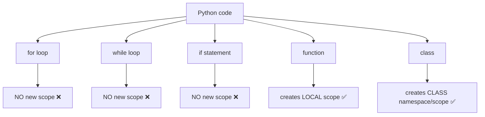

### 14.7 Two variables with the same name

```python
def show(x):        # x here is LOCAL to show()
    print(x)

x = 100             # x here is GLOBAL
show(5)             # prints 5, not 100
print(x)            # prints 100
```

Same name `x`, **two different variables**. Python keeps them in different scopes.

```
GLOBAL scope                 show() LOCAL scope
┌───────────────┐            ┌───────────────┐
│  x ───► 100   │            │  x ───► 5     │
└───────────────┘            └───────────────┘
   different boxes, same label
```

(The full `student` example is in Doubt 4 below.)

> **Revision box:** Only **functions** (and classes) make new scopes. Loops, `if`, `while`, and `with` do **not**.

---

## 15. Mistakes & Doubts I Had

These are the things I was confused about. Read this chapter again before an exam or interview!

### Doubt 1: `sorted()` and `key=`

**My code:**

```python
students = []

with open("a_Data.csv") as file:
    for line in file:
        names, place = line.rstrip().split(",")

        student = {
            "name": names,
            "Place": place
        }

        students.append(student)


def get_student(student):
    return student["name"]


for student in sorted(students, key=get_student):
    print(student)
```

Let's say `a_Data.csv` is:

```
Hermione,Mumbai
Ron,Delhi
Harry,London
```

After reading the file, `students` is:

```python
[
    {"name": "Hermione", "Place": "Mumbai"},
    {"name": "Ron",      "Place": "Delhi"},
    {"name": "Harry",    "Place": "London"},
]
```

#### Q1: What is `student`?

The word `student` is used in **three different places** in this code:

| Place | What is `student` there? |
|-------|--------------------------|
| `student = {...}` inside the file-reading loop | A **dictionary** for one person (global scope) |
| `def get_student(student):` | A **parameter**: a placeholder name inside the function (local) |
| `for student in sorted(...)` | The **loop variable** (global scope) that holds one dictionary at a time |

They are **not the same variable** (see Doubt 4).

#### Q2: Why does `get_student(student)` have a parameter?

The function needs to know **which student** to look at. The parameter is an **empty placeholder** (like a blank in a form):

```python
def get_student(student):     # "I will receive ONE student dictionary"
    return student["name"]    # "and I will give back its name"
```

```
Parameter = the NAME in the def line  → a placeholder (empty box)
Argument  = the REAL VALUE sent in when the function is called → fills the box
```

| Term | Where | Example |
|------|-------|---------|
| **Parameter** | In the `def` line | `student` in `def get_student(student):` |
| **Argument** | In the function **call** | `{"name": "Ron", ...}` in `get_student({"name": "Ron", ...})` |

#### Q3: Where does the actual argument come from?

**`sorted()` supplies it.** `sorted()` goes through the list and hands over **each item, one at a time**, to your function.

You never write `get_student(some_student)` yourself in this code. **`sorted()` calls it for you, behind the scenes.**

#### Q4: Why don't we write `get_student(student)` inside `sorted()`?

Let's try it:

```python
sorted(students, key=get_student(student))   # ❌ wrong
```

This means: *"Call `get_student` **right now** with `student`, and give `sorted()` the **result**."*

Problems:

- Which `student`? Right now it's just whatever the loop variable happens to hold (or it doesn't exist yet → `NameError`).
- `sorted()` would receive a **string** (like `"Harry"`), not a function. It needs a **function** to call many times.

So we pass the function **without** parentheses:

```python
sorted(students, key=get_student)   # ✅ right
```

This means: *"Here is the function. YOU (`sorted`) call it on each item whenever you need."*

#### Q5: `get_student` vs `get_student()` (VERY IMPORTANT)

```
get_student      =  the function ITSELF
                    (a tool you can hand to someone else)
                    → "giving the function to another function"

get_student(x)   =  CALLING the function
                    (using the tool right now, with input x)
                    → runs the code and gives back a result
```

Analogy 🍳:

| | Meaning |
|---|---|
| `get_student` | Handing a **recipe card** to a chef |
| `get_student(student)` | **Cooking the dish now** and handing over the finished dish |

`sorted(students, key=get_student)` = giving `sorted()` the recipe card. `sorted()` decides when and how many times to cook.

You can see the difference:

```python
def get_student(student):
    return student["name"]

print(get_student)                       # <function get_student at 0x...>   ← the function object
print(get_student({"name": "Ron"}))      # Ron                               ← the RESULT of calling it
```

| Code | What it is | Output type |
|------|-----------|-------------|
| `get_student` | The function object | `function` |
| `get_student()` | A call with no argument → ❌ `TypeError` (missing argument) | error |
| `get_student({"name": "Ron"})` | A call → runs the code | `str` |

#### Q6: Who actually calls `get_student()`?

**`sorted()` does.** Not you.

#### Q7: What does `sorted()` do with the function?

For every item in the list, `sorted()`:

1. Calls `get_student(item)`
2. Gets back a value (the **sort key**)
3. Remembers it
4. After all items have values, it sorts the items **by those values**

**Step-by-step execution:**

```
students = [ {Hermione, Mumbai}, {Ron, Delhi}, {Harry, London} ]

sorted() starts...

  Step 1: calls get_student({"name": "Hermione", ...})  →  "Hermione"
  Step 2: calls get_student({"name": "Ron", ...})       →  "Ron"
  Step 3: calls get_student({"name": "Harry", ...})     →  "Harry"

  Now sorted() has these sorting values:
     {Hermione...} → "Hermione"
     {Ron...}      → "Ron"
     {Harry...}    → "Harry"

  Sorts the VALUES alphabetically: "Harry" < "Hermione" < "Ron"

  Result: [ {Harry...}, {Hermione...}, {Ron...} ]   ← the ORIGINAL dictionaries, in the new order
```

Important: the **sorting values** ("Harry", "Ron"...) are only used for deciding the order. The **result list still contains the full dictionaries**.

**The big flow diagram:**

```
students
   │
   ▼
sorted()
   │
   │  gives each student to get_student()
   ▼
get_student(student)
   │
   ▼
student["name"]
   │
   ▼
"name"   (e.g. "Hermione", "Ron", "Harry")
   │
   ▼
sorted according to name
   │
   ▼
[ {Harry...}, {Hermione...}, {Ron...} ]
```

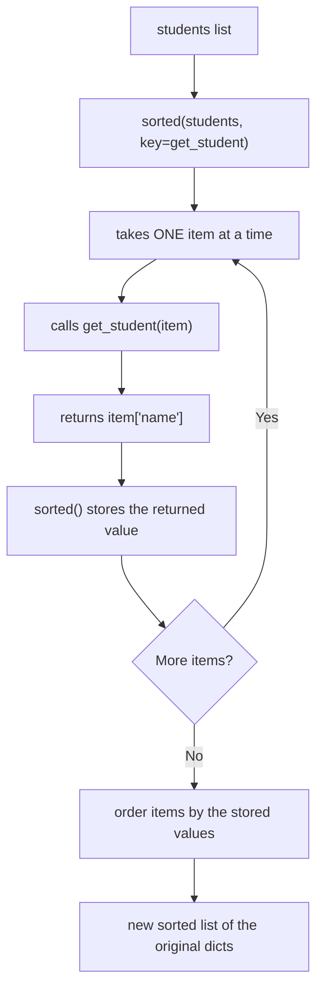

#### Q8: What exactly does `key=` mean?

`key=` means: **"Which value should `sorted()` look at when deciding the order?"**

You give it a function. `sorted()` runs that function on every item, and the **returned value** is used for the comparison.

**Final conclusion:**

> `sorted(students, key=get_student)` means: **`sorted()` will use `get_student` as a tool to find the value that should be used for sorting.** `sorted()` itself calls the function for each item:
> ```
> get_student(student1)
> get_student(student2)
> get_student(student3)
> ```
> then uses the returned values to decide the order.

---

### Doubt 2: `sorted()` WITHOUT `key`

**My code:**

```python
students = []

with open("a_Data.csv") as file:
    for line in file:
        names, place = line.rstrip().split(",")

        students.append(f"{names} lives in {place}")


for student in sorted(students, reverse=True):
    print(student)
```

Here `students` is a list of **strings**:

```python
[
    "Hermione lives in Mumbai",
    "Ron lives in Delhi",
    "Harry lives in London",
]
```

**Output:**

```
Ron lives in Delhi
Hermione lives in Mumbai
Harry lives in London
```

It sorted alphabetically (in reverse), by name! **Why?**

#### Why does it work?

Strings can be compared. Python compares them **character by character, from the left**.

```
"Harry lives in London"
"Hermione lives in Mumbai"
"Ron lives in Delhi"

Compare "Harry..." and "Hermione...":
   H = H     (same, move on)
   a vs e    → 'a' comes before 'e'  → "Harry..." is smaller

Compare "Hermione..." and "Ron...":
   H vs R    → 'H' comes before 'R'  → "Hermione..." is smaller
```

So the normal (ascending) order: `Harry`, `Hermione`, `Ron`. With `reverse=True`: `Ron`, `Hermione`, `Harry`.

#### The important idea ⚠️

`sorted()` is **NOT** thinking: *"These are names, so I'll sort by name."*

`sorted()` is simply **comparing whole strings from left to right**.

It *looks like* sorting by name only because **the name happens to be at the beginning of each string**.

```
String:   H a r r y   l i v e s   i n   L o n d o n
          ▲
          └── comparison starts here, from the LEFT
              (the name is first, so it looks like "sort by name")
```

#### What if the place comes first?

```python
students = [
    "London - Harry",
    "Delhi - Ron",
    "Mumbai - Hermione",
]

for student in sorted(students):
    print(student)
```

**Output:**

```
Delhi - Ron
London - Harry
Mumbai - Hermione
```

Now it is sorted by **place** (D < L < M), because the place is at the **start** of the string.

```
"Delhi - Ron"          starts with D
"London - Harry"       starts with L
"Mumbai - Hermione"    starts with M      →  D < L < M
```

#### Comparison table

| List of strings | `sorted()` compares first | Looks sorted by |
|-----------------|--------------------------|-----------------|
| `"Harry lives in London"` ... | The beginning = **name** | Name |
| `"London - Harry"` ... | The beginning = **place** | Place |

> **Rule:** Without `key`, `sorted()` compares the **items themselves**. Items that are strings are compared left to right, starting from the very first character. What is at the **beginning** of the string matters most.

---

### Doubt 3: What `key=` ACTUALLY means

#### Mental model

```
WITHOUT key:
    sorted(students)
    = sort according to the ITEMS THEMSELVES

WITH key:
    sorted(students, key=get_student)
    = call get_student() on EACH item,
      and sort according to the VALUES IT RETURNS
```

```
WITHOUT key                          WITH key
────────────                         ─────────────────────────────
items ──► compare items directly     items ──► key function ──► values ──► compare values
                                                                               │
                                     result still contains the ORIGINAL items ◄┘
```

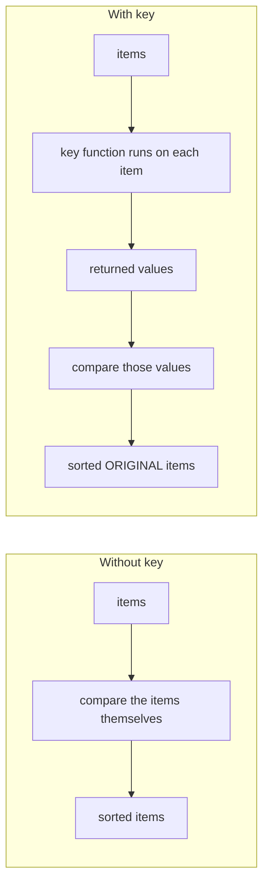

#### `key` is NOT only for strings

It works with **anything**: numbers, lists, dictionaries, tuples...

**Example: sort words by length**

```python
words = ["cat", "elephant", "dog", "ant"]

print(sorted(words, key=len))
```

Here `key=len` means: **"Use the length of each word to decide the order."**

```
sorted() calls:
   len("cat")      → 3
   len("elephant") → 8
   len("dog")      → 3
   len("ant")      → 3

Values:   cat→3   elephant→8   dog→3   ant→3
Sort by value (small to big):  3, 3, 3, 8

Result:  ['cat', 'dog', 'ant', 'elephant']
          (ties keep their original order)
```

Notice: `len` is a function **given without parentheses** (`key=len`, not `key=len()`), exactly like `key=get_student`.

**More examples:**

| Code | What `sorted()` looks at |
|------|--------------------------|
| `sorted(words, key=len)` | The length of each word |
| `sorted(students, key=get_student)` | `student["name"]` |
| `sorted(students, key=lambda s: s["Place"])` | `s["Place"]` |
| `sorted(numbers, key=abs)` | The absolute value of each number |

**So `key` means:** *"What value should `sorted()` look at when deciding the order?"*

---

### Doubt 4: `for` loop scope

#### My question

Is the variable `student` in `for student in students:` local?

#### Answer

**No.** A normal `for` loop does **not** create a separate scope. The loop variable lives in the **surrounding scope**.

```python
for i in range(3):
    x = 10

print(x)    # 10  ✅ works, because the for loop did not create a new scope
print(i)    # 2   ✅ the loop variable is still alive too
```

#### What creates a scope and what doesn't

| Thing | New scope? |
|-------|------------|
| `for` loop | ❌ No |
| `while` loop | ❌ No |
| `if` statement | ❌ No |
| function | ✅ Creates a **local** scope |
| class | ✅ Creates a **class namespace/scope** |

(The full scope map diagram is in [Section 14.6](#146-important-scope-map).)

#### Two DIFFERENT variables named `student`

```python
def get_student(student):          # ← student #1: PARAMETER (local to the function)
    return student["name"]


for student in sorted(students, key=get_student):   # ← student #2: LOOP VARIABLE (global here)
    print(student)
```

```
┌──────────────────────── GLOBAL SCOPE (the surrounding scope) ─────────────────────────┐
│                                                                                        │
│   students = [ {...}, {...}, {...} ]                                                   │
│   get_student = <function>                                                             │
│                                                                                        │
│   for student in ...:    ← student #2 lives HERE (global scope)                        │
│       print(student)        holds one dictionary of the sorted results at a time       │
│                                                                                        │
│   ┌──────────────── get_student() LOCAL SCOPE ───────────────────┐                     │
│   │                                                               │                     │
│   │   student  ← student #1 lives HERE (local only)               │                     │
│   │              it is a different variable; it holds the         │                     │
│   │              item that sorted() passes in for that call       │                     │
│   │                                                               │                     │
│   └───────────────────────────────────────────────────────────────┘                     │
└────────────────────────────────────────────────────────────────────────────────────────┘
```

| | Student #1 | Student #2 |
|---|---|---|
| Where | `def get_student(student):` | `for student in ...:` |
| Type of variable | Function **parameter** | Loop **variable** |
| Scope | **Local** to `get_student()` | **Surrounding** (global here) |
| Who gives it a value? | `sorted()` (each time it calls the function) | The `for` loop (each result from `sorted()`) |
| Lives how long? | Only while the function runs | Still exists after the loop ends |

**The two never mix.** They happen to have the same name, but:

> **Same name does NOT mean same variable.**

The code would work exactly the same if the parameter was renamed:

```python
def get_student(s):
    return s["name"]

for student in sorted(students, key=get_student):
    print(student)
```

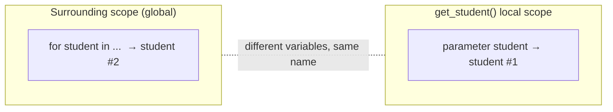

---

### Common Mistakes Table

| Mistake | Why it is wrong | Correct idea |
|---------|-----------------|--------------|
| Writing `key=get_student()` | That **calls** the function immediately (error: missing argument, or it passes a result, not a function) | Write `key=get_student` (no parentheses). Give the function itself; `sorted()` will call it. |
| Thinking `get_student` and `get_student()` are the same | One is the function object, the other runs it | `get_student` = the tool; `get_student(x)` = using the tool now |
| Thinking `for` loops create local scope | Python loops share the surrounding scope | Only functions (and classes) create new scopes. Loop variables stay alive after the loop. |
| Confusing the loop's `student` with the function's `student` parameter | They have the same name but live in different scopes | Two separate variables. The parameter is local to the function. |
| Thinking `sorted()` automatically knows which dictionary value to use | Dictionaries can't be compared directly; Python can't guess | Use `key=` to tell it which value to use |
| Thinking `sorted()` on strings "sorts by name" | It compares whole strings from the left | The first characters decide. Name only wins if it comes first. |
| Using `"w"` when I wanted to add data | `"w"` erases the old content | Use `"a"` to append |
| Forgetting to close a file when not using `with` | Data may not be saved; file stays open | Use `with open(...)`, which closes automatically |
| Confusing `read()`, `readline()`, `readlines()` | Different return types | `read()` → one string; `readline()` → one line; `readlines()` → list of lines |
| Confusing JSON string with JSON file | They need different functions | `load/dump` = file; `loads/dumps` = string |
| Confusing `csv.reader` with `csv.DictReader` | One gives lists, the other gives dicts | `reader` → `row[0]`; `DictReader` → `row["name"]` |
| Forgetting `\n` when using `write()` | `write()` doesn't add newlines | Add `"\n"` yourself |
| Forgetting that CSV values are strings | `"25"` is not the number 25 | Convert with `int()` / `float()` |
| Printing lines without `rstrip()` | Each line includes `\n`, so `print()` doubles it | Use `line.rstrip()` |
| Expecting `sorted()` to change the original list | It returns a **new** list | Save it: `result = sorted(items)` |

---

## 16. Quick Revision Sheet

### Final cheat sheet

| Item | Meaning | Example |
|------|---------|---------|
| `open()` | Opens a file, returns a file object | `file = open("a.txt", "r")` |
| `"r"` | Read mode (default). Error if the file is missing | `open("a.txt", "r")` |
| `"w"` | Write mode. Creates the file, **erases old content** | `open("a.txt", "w")` |
| `"a"` | Append mode. Adds to the **end**, keeps old content | `open("a.txt", "a")` |
| `with open()` | Opens a file and **auto-closes** it | `with open("a.txt") as f:` |
| `read()` | Whole file → **one string** | `f.read()` |
| `readline()` | **One line** (as a string) | `f.readline()` |
| `readlines()` | All lines → **list** of strings | `f.readlines()` |
| `for line in file` | Loop line by line (best for big files) | `for line in f:` |
| `rstrip()` | Removes trailing spaces / `\n` | `line.rstrip()` |
| `write()` | Writes a **string** (no auto newline) | `f.write("Hi\n")` |
| `csv.reader()` | Reads CSV rows as **lists** | `row[0]` |
| `csv.DictReader()` | Reads CSV rows as **dicts** (header = keys) | `row["name"]` |
| `csv.writer()` | Writes rows from **lists** | `writer.writerow([..])` |
| `csv.DictWriter()` | Writes rows from **dicts** (needs `fieldnames`) | `writer.writerow({..})` |
| `json.load()` | JSON **file** → Python | `json.load(f)` |
| `json.dump()` | Python → JSON **file** | `json.dump(data, f)` |
| `json.loads()` | JSON **string** → Python | `json.loads(text)` |
| `json.dumps()` | Python → JSON **string** | `json.dumps(data)` |
| `sorted()` | Returns a **new sorted list** | `sorted(items)` |
| `reverse=True` | Sorts in descending order | `sorted(items, reverse=True)` |
| `key=` | A function that tells `sorted()` which value to compare | `sorted(items, key=len)` |
| `lambda` | A small nameless one-line function | `lambda s: s["name"]` |
| function scope | Variables inside a function are **local** | parameters are local too |
| loop scope | `for` / `while` / `if` do **NOT** create a new scope | loop variables survive the loop |

### Mini revision boxes

> 📦 **Files:** `with open(...)` → work with the file inside the block → auto-closed.
>
> 📦 **Modes:** `r` read · `w` write (erase!) · `a` append.
>
> 📦 **Reading:** `read()` = one string · `readline()` = one line · `readlines()` = list · `for line in file` = loop.
>
> 📦 **JSON:** no `s` = file · with `s` = string. `load/loads` = into Python · `dump/dumps` = out of Python.
>
> 📦 **sorted:** no `key` → compare items themselves · with `key` → compare what the function returns.
>
> 📦 **key=f:** pass `f`, not `f()`. `sorted()` calls it on every item.
>
> 📦 **Scope:** functions make scopes. loops / if / while don't.

### One-picture summary

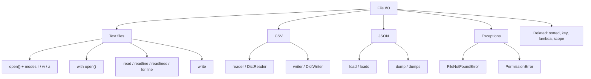

---

## 17. Practice Questions

Try to answer first, then open the answers.

### Part A: Basics

1. What does I/O stand for?
2. What happens if you open a file with `"w"` and the file already has text?
3. What is the difference between `"w"` and `"a"`?
4. Why is `with open(...)` better than `open(...)` followed by `close()`?
5. What is the type returned by `read()`? By `readlines()`?
6. Why do we use `rstrip()` when reading lines?
7. What is the difference between a relative path and an absolute path?

### Part B: CSV and JSON

8. What does `csv.DictReader` return for each row?
9. When would you prefer `DictReader` over `reader`?
10. What is the difference between `json.load()` and `json.loads()`?
11. What does `json.dumps({"ok": True})` return?
12. Why are all values from a CSV file strings?

### Part C: Exceptions

13. Name two reasons a `FileNotFoundError` can happen.
14. Write a `try/except` that prints a friendly message if `data.txt` doesn't exist.

### Part D: `sorted()`, `key=`, scope

15. What is the difference between `get_student` and `get_student()`?
16. Who calls the function passed to `key=`?
17. What will `sorted(["cat", "elephant", "dog", "ant"], key=len)` return?
18. Why does `sorted(["Harry lives in London", "Ron lives in Delhi"])` seem to sort by name?
19. What would change if the strings were `"London - Harry"` and `"Delhi - Ron"`?
20. Does this work? Why?
    ```python
    for i in range(3):
        x = 10
    print(x)
    ```
21. In the code below, are the two `student` variables the same?
    ```python
    def get_student(student):
        return student["name"]

    for student in sorted(students, key=get_student):
        print(student)
    ```
22. Rewrite `def get_student(student): return student["name"]` as a `lambda`.

### Part E: Small coding tasks

23. Write code that saves `["Harry", "Ron", "Hermione"]` into `names.txt`, one name per line.
24. Write code that adds the name `"Neville"` to the end of `names.txt` without deleting the others.
25. Read `students.csv` with `DictReader` and print the names sorted from Z to A.
26. Save this dictionary into `info.json`, then load it back and print the age: `{"name": "Harry", "age": 17}`.

<details>
<summary><b>Click to see answers</b></summary>

1. Input / Output.
2. The old text is **erased** (overwritten).
3. `"w"` erases the old content and starts fresh. `"a"` keeps the old content and adds to the end.
4. It closes the file **automatically**, even if an error happens.
5. `read()` → a single `str`. `readlines()` → a `list` of `str`.
6. Each line ends with `\n`. `rstrip()` removes it so `print()` doesn't add blank lines and your data is clean.
7. Relative = starts from the current working directory. Absolute = the full address from the top of the drive.
8. A dictionary (keys come from the header row).
9. When the file has a header row. Code is more readable (`row["name"]`) and doesn't depend on column positions.
10. `load()` reads from a **file**. `loads()` reads from a **string**.
11. The **string** `'{"ok": true}'`.
12. CSV is plain text. It has no data types, so everything is read as text. Convert with `int()` / `float()`.
13. Wrong file name (typo), wrong folder / current working directory, file doesn't exist yet (opened with `"r"`).
14. ```python
    try:
        with open("data.txt") as file:
            print(file.read())
    except FileNotFoundError:
        print("data.txt was not found.")
    ```
15. `get_student` is the **function itself**. `get_student()` **calls** it (and here would fail because it needs an argument).
16. `sorted()` calls it, once for each item.
17. `['cat', 'dog', 'ant', 'elephant']`
18. Strings are compared from the left. The name is at the beginning, so it decides the order, but `sorted()` is not "thinking about names".
19. It would sort by **place** (Delhi before London) because the place is at the beginning.
20. Yes, it prints `10`. A `for` loop does not create a new scope.
21. No. One is a local **parameter** in `get_student()`. The other is the loop variable in the surrounding scope. Same name, different variables.
22. `lambda student: student["name"]`
23. ```python
    names = ["Harry", "Ron", "Hermione"]
    with open("names.txt", "w") as file:
        for name in names:
            file.write(name + "\n")
    ```
24. ```python
    with open("names.txt", "a") as file:
        file.write("Neville\n")
    ```
25. ```python
    import csv

    with open("students.csv") as file:
        students = list(csv.DictReader(file))

    for student in sorted(students, key=lambda s: s["name"], reverse=True):
        print(student["name"])
    ```
26. ```python
    import json

    info = {"name": "Harry", "age": 17}

    with open("info.json", "w") as file:
        json.dump(info, file, indent=4)

    with open("info.json") as file:
        data = json.load(file)

    print(data["age"])
    ```

</details>

---

## 18. Final File I/O Checklist

Tick these off only when you can do them **without looking**:

**Files**
- [ ] I can explain what File I/O is and why it is needed
- [ ] I can use `open()` with `"r"`, `"w"`, and `"a"`
- [ ] I know `"w"` erases and `"a"` adds
- [ ] I always use `with open(...)`
- [ ] I can explain `read()`, `readline()`, `readlines()`, and `for line in file`
- [ ] I know why `rstrip()` is needed
- [ ] I remember `write()` does not add `\n`
- [ ] I understand relative vs absolute paths and the current working directory

**CSV**
- [ ] I can read a CSV manually with `split(",")`
- [ ] I can use `csv.reader` and `csv.DictReader`
- [ ] I can use `csv.writer` and `csv.DictWriter`
- [ ] I know why `DictReader` is more readable

**JSON**
- [ ] I can describe objects, arrays, and key-value pairs
- [ ] I know how Python types map to JSON types
- [ ] I can use `load`, `dump`, `loads`, `dumps`, and know when to use each
- [ ] I understand why JSON matters for APIs and AI work

**Exceptions**
- [ ] I can handle `FileNotFoundError` and `PermissionError` with `try/except`

**sorted / key / lambda**
- [ ] I can explain `get_student` vs `get_student()`
- [ ] I can explain that `sorted()` calls the `key` function on each item
- [ ] I can explain why `sorted()` without `key` compares the items themselves
- [ ] I can use `key=len` and `key=lambda ...`
- [ ] I can use `reverse=True`

**Scope**
- [ ] I know `for`, `while`, and `if` don't create a new scope
- [ ] I know functions create local scope and classes create a class namespace
- [ ] I can explain why the loop `student` and the parameter `student` are different variables

---

### ✅ Next step

When most boxes are ticked, move on to:

```
Python (File I/O ✅) → NumPy → Pandas → Matplotlib / Seaborn → Machine Learning → AI Engineering
```